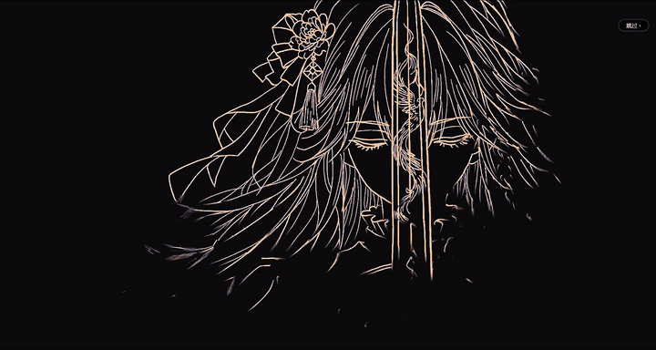
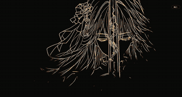

<div align="center">

# AgentSplash Bot

### Your AI workspace, with an entrance.

Animated splash screens and translucent backgrounds for AI agent desktop apps,<br>including **Claude, ChatGPT, and Codex**.

<p>
<a href="https://github.com/ShuaixinHuang/agent-splash-bot/releases/latest"></a>  <a href="LICENSE"></a>
</p>

**Windows · macOS · Linux X11**

[**Download v0.2.0**](https://github.com/ShuaixinHuang/agent-splash-bot/releases/tag/v0.2.0) &nbsp; · &nbsp; [Get started](#quick-start) &nbsp; · &nbsp; [Showcase](#showcase) &nbsp; · &nbsp; [Features](#features)

</div>

<p align="center">
  
</p>

<p align="center"><sub>Real footage. Inline animated previews. Three different moods for your agent workspace.</sub></p>

## Showcase

<table>
  <tr>
    <th width="33%">01 · Warm amber</th>
    <th width="33%">02 · Electric violet</th>
    <th width="33%">03 · Celestial wings</th>
  </tr>
  <tr>
    <td></td>
    <td></td>
    <td></td>
  </tr>
  <tr>
    <td align="center"><a href="https://github.com/ShuaixinHuang/agent-splash-bot/blob/main/1.mp4">Full recording · MP4</a></td>
    <td align="center"><a href="https://github.com/ShuaixinHuang/agent-splash-bot/blob/main/2.mp4">Full recording · MP4</a></td>
    <td align="center"><a href="https://github.com/ShuaixinHuang/agent-splash-bot/blob/main/3.mp4">Full recording · MP4</a></td>
  </tr>
</table>

The previews above loop automatically. Open a full recording for the original resolution and any included audio.

> **Showcase and release:** These maintainer-provided recordings show character-based visual concepts. The v0.2.0 Python package renders procedural Aurora, Ember, and Orbit effects; character artwork, video, and audio are not bundled with the application.

## Features

| Make an entrance | Keep your workflow |
| --- | --- |
| **Three real-time themes** — Aurora, Ember, and Orbit, drawn with Python and Qt. | **Click-through overlays** — keep using the application beneath the animation. |
| **A short intro, then a background** — tune duration, opacity, and frame rate. | **Window tracking** — show effects on matching foreground apps and hide them when you switch away. |
| **Preview and replay** — try a theme on its own or replay it from the tray. | **One intro per window** — avoid repeated intros when switching back during a session. |
| **PNG export** — save a rendered frame directly from the command line. | **On-demand rendering** — pause the animation timer while hidden; 30 FPS by default. |

### Built-in themes

| Aurora | Ember | Orbit |
| :---: | :---: | :---: |
| Flowing aurora effects | Glowing ember particles | Orbital star trails |
| `--theme aurora` | `--theme ember` | `--theme orbit` |

### How it works

1. **Launch** AgentSplash Bot from your virtual environment.
2. **Match** your agent application's process name or window identity.
3. **Enjoy** the intro and optional translucent background; adjust or pause them from the tray.

## Quick start

Requires **Python 3.10 or later**; Python 3.12 is recommended. The Python package and command are named `aurora-boot`.

Download `aurora_boot-0.2.0-py3-none-any.whl` and `SHA256SUMS` from the [v0.2.0 release](https://github.com/ShuaixinHuang/agent-splash-bot/releases/tag/v0.2.0), verify the checksum, and run the following commands from your download directory.

### Windows PowerShell

```powershell
py -3 -m venv .venv
.\.venv\Scripts\python.exe -m pip install .\aurora_boot-0.2.0-py3-none-any.whl
.\.venv\Scripts\aurora-boot.exe --demo
```

### macOS / Linux

```sh
python3 -m venv .venv
. .venv/bin/activate
python -m pip install ./aurora_boot-0.2.0-py3-none-any.whl
aurora-boot --demo
```

Press **Esc** to close the standalone preview.

Releases provide a cross-platform Python wheel and a source archive. They are not standalone EXE or APP bundles; pip installs PySide6 and the appropriate platform dependencies.

<details>
<summary>Linux graphics dependencies</summary>

Linux requires the Qt graphics runtime libraries. Debian / Ubuntu X11 installations typically need `libegl1`, `libgl1`, `libxkbcommon-x11-0`, `libxcb-cursor0`, and `libxcb-icccm4`.

If Qt reports missing `xcb` platform plugin dependencies, install the required libraries through your system package manager. PNG rendering with `--render` can use Qt's offscreen mode.

</details>

## Platform support

| Platform | Window tracking | Standalone preview / PNG export |
| --- | --- | --- |
| Windows 10/11 | Win32 foreground window and client area; display scaling support | Supported |
| macOS 13+ | Quartz window information and foreground application | Supported |
| Linux X11 | EWMH active window; system tray required | Supported |
| Linux Wayland | Global window tracking is not currently supported | Supported |

Window tracking and overlay stacking depend on the window manager. Linux mixed-DPI setups, multiple displays with different scaling, and macOS fullscreen spaces require testing on the actual device.

Application matching uses process names on Windows, bundle IDs and application names on macOS, and WM_CLASS on Linux. For third-party Linux clients, enter the corresponding application identity in settings.

## Usage

The commands below assume the virtual environment is active. On Windows, use `.\.venv\Scripts\aurora-boot.exe` in place of `aurora-boot` if the environment is not activated.

### Preview a theme

```sh
aurora-boot --demo --theme orbit
```

### Follow application windows

```sh
aurora-boot --match claude,chatgpt,codex,antigravity
```

To match another application:

```sh
aurora-boot --match firefox
```

On Linux X11, use `xprop WM_CLASS` to inspect a window's identity.

Window tracking requires a system tray. GNOME may need an AppIndicator extension. Use the tray menu to preview, replay, change settings, pause, or quit.

### Export a PNG frame

```sh
aurora-boot --render frame.png --theme ember --time 2.5
```

This exports one frame without starting window tracking.

### Inspect the environment

```sh
aurora-boot --diagnose
```

## Configuration

By default, the intro lasts **3.5 seconds**, followed by an animated background at **18% opacity**. Disable the background in settings if you only want the intro.

Theme and matching options passed through the CLI apply to the current launch. Save them in the settings window to persist them.

| Platform | Configuration path |
| --- | --- |
| Windows | `%APPDATA%\aurora-boot\config.json` |
| macOS | `~/Library/Application Support/aurora-boot/config.json` |
| Linux | `$XDG_CONFIG_HOME/aurora-boot/config.json`; defaults to `~/.config/aurora-boot/config.json` |

Use `--config` to select a separate configuration file. Invalid files are backed up in the same directory as `config.json.invalid-*`.

The application does not register itself to start at login, modify other applications' files, or play audio.

## Development

From a source checkout:

```sh
python -m pip install -e .
python -m unittest discover -s tests -v
python -m aurora_boot.app --smoke-test
python -m build
```

CI runs configuration, window matching, rendering, lifecycle, and startup checks on Linux, Windows, and macOS. Automated tests do not guarantee compatibility with every desktop, window manager, or target application.

## License

The application code and procedurally generated graphics are released under the [Unlicense](LICENSE), allowing use, modification, and redistribution without attribution. Dependencies retain their own licenses; see [DEPENDENCIES.md](DEPENDENCIES.md).

See the [changelog](CHANGELOG.md) for release history.
